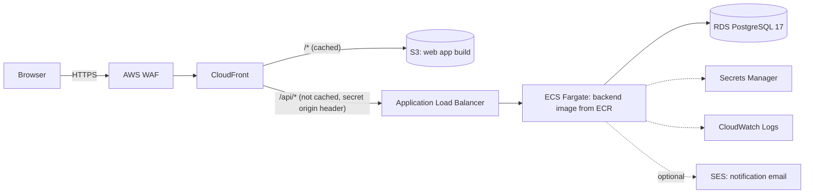

# AWS deployment plan (Phase 3)

Status: **designed, paused for cost** (2026-11-16). The public demo runs on free hosting instead
([deployment.md](deployment.md#free-hosting-render--neon)). Nothing here has been created in AWS;
the decisions below are still open. Costs are estimates to confirm with the AWS Pricing Calculator for
the chosen region; they are not quotes.

## Target

- **One origin for the browser.** CloudFront serves the web app from S3 and forwards `/api/*` to the
  load balancer, so the app stays same-origin exactly as with nginx today: no CORS, and the refresh
  cookie keeps `SameSite=Strict` and `Path=/api/auth`.
- **The same backend image** as Compose, with `SPRING_PROFILES_ACTIVE=prod` (no demo profile unless
  decided otherwise). Flyway migrates at start-up as it does now; its lock makes a rolling update
  with two tasks safe.
- **Only CloudFront reaches the load balancer:** its security group allows CloudFront's managed
  prefix list, and a listener rule forwards only requests carrying a secret header that CloudFront
  adds (anything else gets 403).
- **Secrets** (database password managed by RDS, JWT key, demo password if any) live in Secrets
  Manager and reach the container as environment variables through the task definition.
- **Infrastructure as code:** Terraform, state in an S3 bucket with native locking. Applied by a
  person, never automatically from CI.

## What has to change in the code first (no AWS account needed)

1. **Client address behind CloudFront.** Today nginx overwrites `X-Forwarded-For`. Behind CloudFront
   and the ALB, Spring would see CloudFront's edge address, and the sign-in throttle would treat
   everyone using one edge as one client. Fix: CloudFront forwards `CloudFront-Viewer-Address`; an
   `aws` profile reads the client address from it (trusted, because the ALB only accepts requests
   with CloudFront's secret header). Covered by a test.
2. **Security headers for the web app.** nginx adds the CSP and the other headers today. On AWS a
   CloudFront response-headers policy carries the same values, and cache behaviours match today's
   (`index.html` never cached, `/assets/*` cached for a year).
3. **Upload limit at the edge.** nginx capped bodies at 11 MB. The backend's own 10 MB limit
   still applies; the WAF rule set gets a body-size rule for `/api/tickets/*/attachments`.
4. **Attachments:** keep them in PostgreSQL at first (ADR-014). Optional later milestone: an S3
   `AttachmentContentStore` with the bucket private and versioned.
5. **Email:** off by default on AWS; in-app notifications work without it. With a domain, SES sends
   them (see the email decision below).

## Milestones

| # | What | Needs your account? | Outcome |
|---|---|---|---|
| M29 | Code changes above, Terraform for everything in the diagram (modules: network, data, compute, edge, observability), `terraform fmt`/`validate`/`tflint` and Checkov in CI, a deploy workflow (build → ECR → ECS, web build → S3, CloudFront invalidation) that can't run yet | No | Reviewed, tested code and infrastructure definitions |
| M30 | Bootstrap: you create the account access and budget alarm; I write the bootstrap (state bucket, GitHub OIDC role with least privilege, ECR); `terraform plan` shown to you before any apply | Yes | Empty but ready AWS environment, CI can deploy without stored keys |
| M31 | First deployment: apply, push images, run the smoke test against the CloudFront URL, browser check | Yes (apply needs your yes) | The app live on a CloudFront URL |
| M32 | WAF (managed common rules + rate rule on `/api/auth/login`), CloudWatch alarms (5xx, unhealthy targets, RDS CPU/storage/connections), dashboards, a runbook including teardown | Yes | Production hygiene, documented |

## Rough monthly cost (always on, single region, smallest sizes)

| Item | Size | Estimate (USD) |
|---|---|---|
| ECS Fargate | 1 task, 0.5 vCPU, 1 GB (ARM) | ~15 |
| RDS PostgreSQL | db.t4g.micro, single-AZ, 20 GB gp3, 7-day backups | ~15–18 |
| Application Load Balancer | 1, light traffic | ~18–20 |
| CloudFront, S3, ECR, Secrets Manager, CloudWatch | light traffic, short log retention | ~3–6 |
| WAF (M32) | 1 web ACL, 2–3 rules | ~7–8 |
| **Total** | | **~60–70** |

Ways to spend less, each with a cost:
- **No NAT gateway** (~$35 a month saved): tasks run in public subnets with a public IP but accept
  traffic only from the load balancer. The alternative is private subnets with VPC endpoints.
- **Scale to zero when not demoing:** ECS desired count 0 and RDS stopped brings it to roughly
  $20–25 (the load balancer still bills). RDS restarts itself after 7 days stopped.
- **Free tier / credits** may cover part of RDS and Fargate for a new account.
- A budget alarm (for example $30 and $75) is created first, before anything else.

## Decisions needed

1. **AWS account:** do you have one I'd deploy into, and will you sign in yourself (AWS IAM Identity
   Center / `aws sso login`)? I never handle your credentials; I run commands only with the session
   you've signed into.
2. **Region:** eu-west-2 (London) suggested, matching the business-hours zone.
3. **Budget:** always on (~$60–70 a month), or scaled to zero between demos (~$20–25)?
4. **Domain:** use the free `*.cloudfront.net` address, or a domain you own (ACM certificate, nicer
   URL, and needed for SES email)?
5. **Demo data online:** seed the demo accounts so recruiters can sign in (password shared only by
   you), or start empty with just the bootstrap admin?
6. **Email:** keep notification email off on AWS, or set up SES (needs the domain, and leaving SES's
   sandbox to email anyone)?
7. **Approval of each apply:** I'll show every `terraform plan` and apply only after you say yes;
   CI never applies on its own. Confirm that's how you want it.
