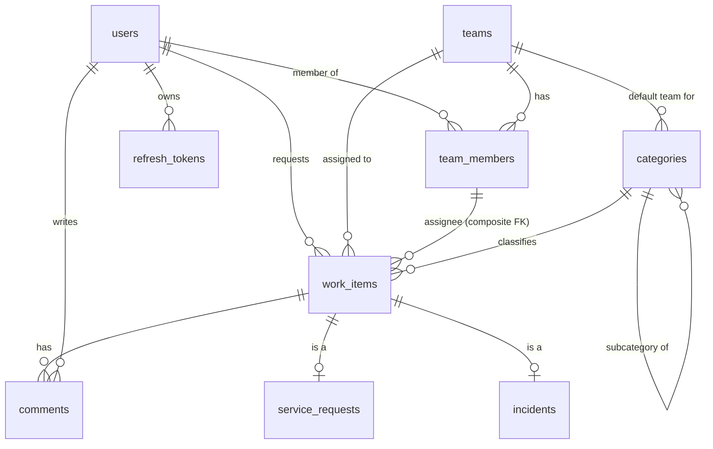

# Database design

PostgreSQL 17 ([ADR-002](adr/002-postgresql.md)). Every schema change is a Flyway migration in
`backend/src/main/resources/db/migration`. Hibernate validates the schema and never creates it.

## Implemented

| Migration | Contents |
|---|---|
| `V1__baseline.sql` | No tables. Proves the migration pipeline end to end |
| `V2__users_and_teams.sql` | `users`, `teams`, `team_members` (M1) |
| `V3__refresh_tokens.sql` | `refresh_tokens` (M2) |
| `V4__tickets_and_audit.sql` | `categories`, `work_items`, `incidents`, `service_requests`, reference sequences, `audit_events` + append-only trigger (M3) |
| `V5__assignment_membership_rules.sql` | Replaces V4's composite assignee FK with two triggers (see below); index `(assigned_team_id, assignee_id)` (M5) |
| `V6__comments.sql` | `comments` (M6) |
| `V7__ticket_search_and_queue_indexes.sql` | `search_vector` generated column + GIN index, partial index for the unassigned queue, category indexes (M7) |
| `V8__sla.sql` | `sla_policies` (seeded with default targets), `sla_clocks` + breach index (M15) |
| `V9__service_catalogue.sql` | `catalogue_items`; foreign key and `catalogue_answers` on `service_requests` (M18) |
| `V10__approvals.sql` | `catalogue_items.approval_required`, `approvals` + pending index (M19) |
| `V11__problems.sql` | `problems`, `problem_ref_seq`, the `PROBLEM` type and its statuses on `work_items`, `incidents.problem_id` + partial index (M20) |
| `V12__changes.sql` | `changes`, `change_ref_seq`, the `CHANGE` type and its statuses on `work_items`, window and problem indexes (M21) |

### users

| Column | Type | Notes |
|---|---|---|
| `id` | `uuid` PK | UUIDv7, generated by the application (time-ordered, so B-tree friendly) |
| `email` | `varchar(254)` NOT NULL | `UNIQUE`; `CHECK (email = lower(btrim(email)))` makes the unique constraint case-insensitive |
| `display_name` | `varchar(120)` NOT NULL | not blank |
| `password_hash` | `varchar(255)` NOT NULL | `{bcrypt}…`; the algorithm prefix allows a later migration to Argon2 |
| `role` | `varchar(20)` NOT NULL | `CHECK IN (REQUESTER, AGENT, TEAM_LEAD, ADMIN)` |
| `active` | `boolean` | Users are deactivated, never deleted |
| `created_at`, `updated_at` | `timestamptz` | |
| `version` | `bigint` | Optimistic locking |

Index: `(role, active)` serves the "active admins" lock query and role filters.

### teams

`id`, `name varchar(100)`, `description varchar(500)`, `active`, timestamps, `version`.
Unique index on `lower(name)` ("Network Team" and "network team" can't coexist), and the name
can't be blank.

### team_members

`team_id → teams`, `user_id → users`, `joined_at`; **PK `(team_id, user_id)`**, plus an index on
`user_id` for "teams of a user". Foreign keys use the default `RESTRICT`, so a user or team with
memberships can't be hard-deleted.

### refresh_tokens

| Column | Notes |
|---|---|
| `id` uuid PK, `user_id` → users | |
| `family_id` uuid | All tokens from one login. Revocation is per family |
| `token_hash` varchar(64) | SHA-256 hex of the cookie value; `UNIQUE`; `CHECK` hex format |
| `issued_at`, `expires_at` | `CHECK (expires_at > issued_at)`; successors inherit `expires_at` (absolute session) |
| `used_at` | Set on rotation; a used token presented again means reuse |
| `revoked_at`, `revocation_reason` | Both null or both set (CHECK); reason in `LOGOUT, REUSE_DETECTED, PASSWORD_CHANGED, USER_INACTIVE` |

Indexes: `family_id`, `user_id`, `expires_at` (for the future purge job).

### categories

Two levels (`parent_id` → top-level category). `code` is unique UPPER_SNAKE_CASE; `applies_to` is
`INCIDENT | SERVICE_REQUEST | ANY`. **`CHECK (parent_id IS NOT NULL OR default_team_id IS NOT NULL)`**:
every top-level category routes to a team, so every ticket is routable. A subcategory's team, if
set, overrides its parent's.

### work_items, incidents, service_requests (JPA `JOINED` inheritance)

`work_items` holds every shared column: `reference` (unique, `^(INC|REQ|PRB|CHG)-[0-9]{6,}$`), `type`
(discriminator), `title`, `description`, `status`, `impact`, `urgency`, `priority`, `category_id`,
`subcategory_id`, `requester_id`, `assigned_team_id` (**NOT NULL**), `assignee_id`, lifecycle
timestamps and `version`. `incidents`, `service_requests`, `problems` and `changes` share its primary key
(`work_item_id`, `ON DELETE CASCADE`) and add type-specific columns.

| Guarantee | Mechanism |
|---|---|
| Status belongs to the type | `work_items_status_check`: `(type, status)` pairs |
| Unique, race-free references | `incident_ref_seq` / `service_request_ref_seq` / `problem_ref_seq` / `change_ref_seq` + `UNIQUE (reference)` |
| Assignee is in the assigned team **when assigned** | trigger `work_items_assignee_membership` (BEFORE INSERT/UPDATE OF assignee/team) |
| A member can't leave a team while owning **open** tickets there | trigger `team_members_no_open_assignments` (BEFORE DELETE) |
| Valid impact/urgency/priority | `CHECK ... IN (...)` |

Indexes: `(requester_id, created_at DESC)` for "my tickets"; `(assigned_team_id, status)`,
`(assignee_id, status)` and `(assigned_team_id, assignee_id)` for queues; `(created_at)` for
reporting; `category_id` / `subcategory_id` for filters and name search. Added in V7, with their
effect measured in [performance.md](performance.md):

- `search_vector tsvector GENERATED ALWAYS AS (weight A: title, weight B: description) STORED`
  with a **GIN** index. PostgreSQL maintains it, so it can't drift; it isn't mapped in JPA.
- **Partial** index `work_items_unassigned_queue_idx (assigned_team_id, created_at) WHERE
  assignee_id IS NULL AND status NOT IN ('CLOSED','CANCELLED','REJECTED')`. It only holds tickets
  that can appear in a pick-up queue, however many get closed.

> **Why triggers instead of the original composite FK (V4 → V5):** a foreign key holds for the
> row's whole life. Closed tickets keep their historical assignee, so the FK made it impossible to
> ever remove someone from a team they had once worked in. The real rule is about *assignment time*
> and *open* tickets, which a trigger can express. See [ADR-008](adr/008-assignment-membership-triggers.md).

### comments

`work_item_id` → work_items (`ON DELETE CASCADE`), `author_id` → users, `visibility`
(`PUBLIC | INTERNAL`), `body` (not blank, at most 10,000 characters, both CHECKs), `related_status`
(set when the comment is the reason for a status change), `created_at`. Index
`(work_item_id, created_at, id)` serves the thread in order. Immutable in the application.

### audit_events

`occurred_at`, `actor_id` (NULL = system), `action`, `entity_type`, `entity_id`, `old_value` /
`new_value` / `metadata` (**jsonb**), `correlation_id`. No foreign keys, so the trail never blocks
or depends on what it describes. **A `BEFORE UPDATE OR DELETE` trigger raises `restrict_violation`**,
making it append-only at the database level. Indexes: `(entity_type, entity_id, occurred_at)` for
timelines and `(actor_id, occurred_at)`.

### sla_policies (Phase 2, M15)

One row per `ticket_type` × `priority` (UNIQUE), seeded by V8 with the default targets:
`response_minutes` and `resolution_minutes`, both positive, response no later than resolution
(CHECK). Reference data rather than demo data: every ticket must find its policy, so admins change
the numbers but never the rows. The integration-test cleaner keeps this table.

### sla_clocks (Phase 2, M15)

One clock per ticket and `metric` (`RESPONSE | RESOLUTION`, UNIQUE with `work_item_id` →
work_items, `ON DELETE CASCADE`). Time is stored as `elapsed_ms` (finished running stretches) plus
`running_since` (the current stretch), so pausing and reopening keep the time already used.
`state` is `RUNNING | PAUSED | COMPLETED | CANCELLED`; CHECKs tie `running_since` and `due_at` to
`RUNNING` and `completed_at` to `COMPLETED`. `breached_at` records a breach permanently. The
partial index `(due_at) WHERE state = 'RUNNING' AND breached_at IS NULL` is what the breach job
scans. See [ADR-010](adr/010-sla-clocks.md).

### catalogue_items (Phase 2, M18)

`name` (unique ignoring case, through a unique index on `lower(name)`), `summary`, `description`,
`category_id` and optional `subcategory_id` (→ categories; they route the request, so the item
needs no team of its own), `form_fields` (**jsonb**, CHECK: an array), `active`, timestamps and
`version`. The form is JSON rather than a table of fields because it is always read and saved
whole and never queried by field; `CatalogueForm` validates it on every save. Items are withdrawn
(`active = false`), never deleted.

`service_requests.catalogue_item_id` now references `catalogue_items`, and
`service_requests.catalogue_answers` (**jsonb**) keeps each answer with the question's label as it
read when the request was raised. A CHECK makes the two columns go together: both NULL for a
free-text request, item plus an answers array for a catalogue one.

### approvals (Phase 2, M19)

One row per request that needs sign-off (`work_item_id` UNIQUE → work_items, `ON DELETE CASCADE`).
`status` is `PENDING | APPROVED | REJECTED | WITHDRAWN`. `decided_by` (→ users), `decided_at` and
`comment` (at most 2,000 characters). CHECKs: only a pending approval has no `decided_at`; exactly
approvals and rejections have a `decided_by`; a rejection has a non-blank comment. Who may decide
isn't stored: it follows the request's assigned team at decision time. The partial index
`(created_at) WHERE status = 'PENDING'` serves the inbox. `catalogue_items.approval_required`
(default false) marks items whose requests need it.

### problems (Phase 2, M20)

One row per problem ticket (`work_item_id` → work_items, `ON DELETE CASCADE`): `root_cause`,
`workaround`, `known_error_at` (first time it became a known error), `fix_notes` and
`reopen_count`. Which fields a status needs (a known error has a root cause and workaround) is
checked by the application, since the status lives in `work_items`. `incidents.problem_id`
(→ problems) links an incident to the problem behind it; the partial index
`incidents_problem_idx (problem_id) WHERE problem_id IS NOT NULL` lists a problem's incidents.

### changes (Phase 2, M21)

One row per change ticket (`work_item_id` → work_items, `ON DELETE CASCADE`): `change_type`
(`STANDARD | NORMAL | EMERGENCY`), `risk` (`LOW | MEDIUM | HIGH`), `implementation_plan`,
`backout_plan`, `planned_start`, `planned_end`, `problem_id` (→ problems, the problem it fixes),
`implemented_at`, `outcome` (`SUCCESSFUL | SUCCESSFUL_WITH_ISSUES | FAILED | BACKED_OUT`) and
`review_notes`. CHECKs: a standard change is low risk; the window ends after it starts; an outcome
and its notes come together. That the plan is complete before submission is checked by the
application, since it depends on status. The partial index `changes_window_idx (planned_start,
planned_end)` serves the schedule and clash lookups, and `changes_problem_idx` lists a problem's
changes. Approvals reuse the `approvals` table.

## Conventions

- Migrations are **immutable once merged**. A fix is a new migration.
- Primary keys are `uuid`. Human-readable references (`INC-000001`) are a separate unique column.
- All timestamps are `timestamptz`, and the application reads and writes UTC.
- Mutable aggregates have a `version bigint` column for optimistic locking.
- Enumerations are stored as `varchar` with a `CHECK` constraint, so they stay readable in SQL,
  remain migration-friendly, and still get database-level validation.
- Business invariants are enforced in the service **and**, where cheap, in the database.

## Phase 1 entity relationships

Added in Phase 2 so far: `sla_policies`, `sla_clocks`, `catalogue_items`, `approvals`, `problems`,
`changes` (described above). Tables still to come in Phase 2: `attachments`, `notifications`.
